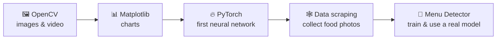
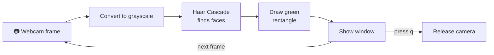
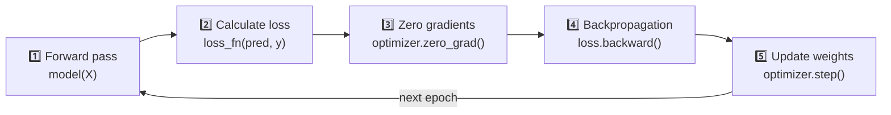
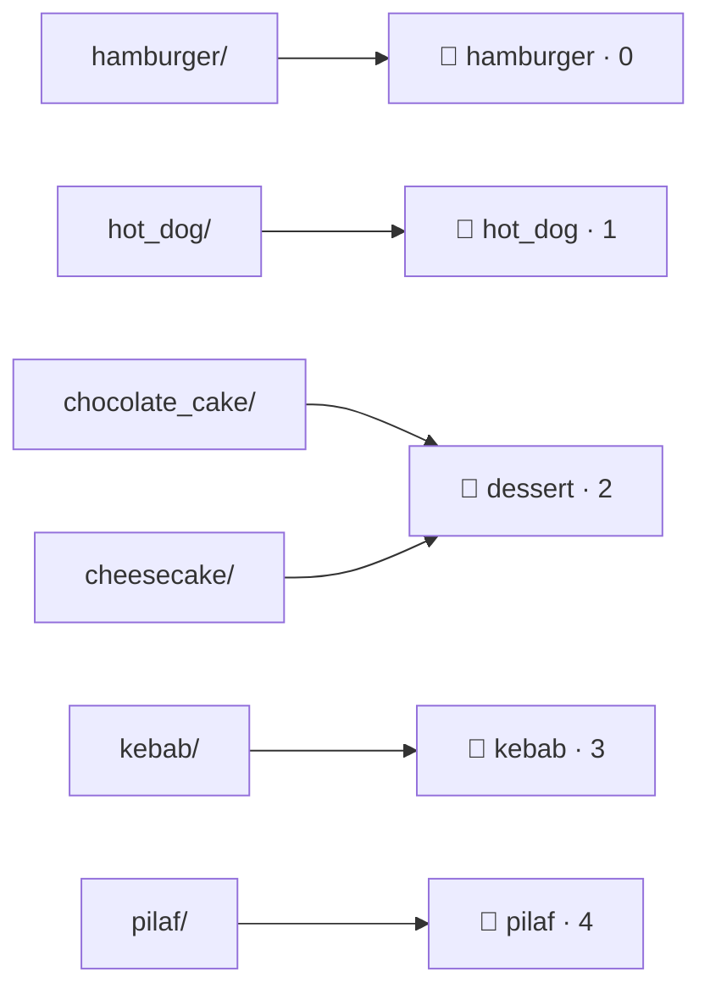
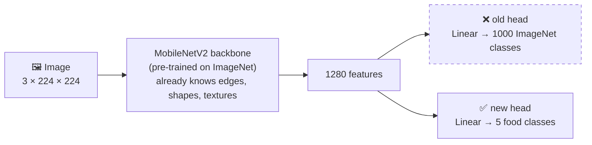
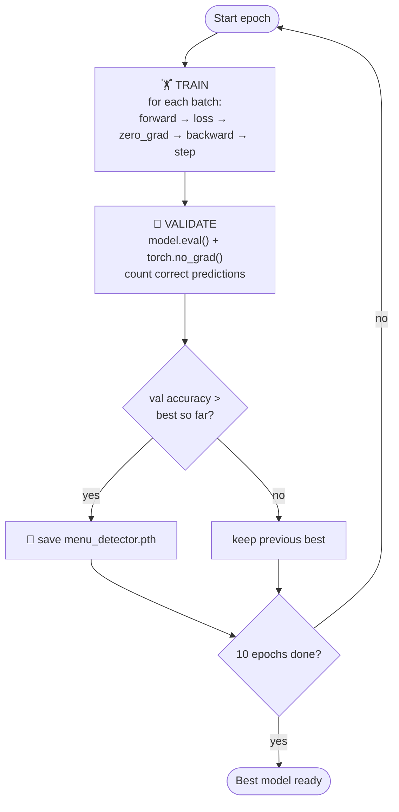
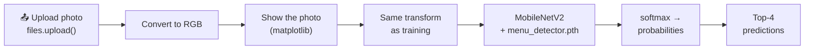

# 🍽️ Computer Vision — from OpenCV basics to a Food Menu Detector

This project starts with reading a single image with OpenCV and ends with a **trained AI model that looks at a food photo and tells you what dish it is**.



**Final result:** a fine-tuned **MobileNetV2** model that recognises **5 food classes** with **91.06% validation accuracy**.

| 🍔 hamburger | 🌭 hot_dog | 🍰 dessert | 🍢 kebab | 🍚 pilaf |
|:---:|:---:|:---:|:---:|:---:|

---

## Contents

1. [Repository structure](#repository-structure)
2. [Part 1 — OpenCV: images and video](#part-1--opencv-images-and-video)
3. [Part 2 — Matplotlib: drawing charts](#part-2--matplotlib-drawing-charts)
4. [Part 3 — PyTorch: my first neural network](#part-3--pytorch-my-first-neural-network)
5. [Part 4 — Menu Detector: the main project](#part-4--menu-detector-the-main-project)
6. [How to run it](#how-to-run-it)
7. [Tech stack](#tech-stack)
8. [Known limitations and next steps](#known-limitations-and-next-steps)

---

## Repository structure

```
computer_vision/
├── cv_opencv.ipynb            # Part 1 — image processing + webcam face detection
├── matplotlib.ipynb           # Part 2 — line, bar, scatter, histogram, subplots, 3D plots
├── pytorch.ipynb              # Part 3 — tensors + linear regression neural network
├── data_scraping.ipynb        # Part 4 — download food photos from Bing to Google Drive
├── menu_detector_model.ipynb  # Part 4 — dataset → training → prediction
└── README.md
```

All notebooks were written and run in **Google Colab**. Each one has an "Open in Colab" badge at the top.

---

## Part 1 — OpenCV: images and video

📓 [`cv_opencv.ipynb`](cv_opencv.ipynb) · [](https://colab.research.google.com/github/asilbek1301/computer_vision/blob/main/cv_opencv.ipynb)

### 1.1 Working with an image

I loaded a cat photo and learned what an image really is: **a grid of numbers**.

```
image.shape  →  (800, 736, 3)
                  │    │   └── 3 colour channels (OpenCV order is B, G, R — not RGB!)
                  │    └────── width  (pixels)
                  └─────────── height (pixels)
```

Reading one pixel gives three numbers: `image[100, 50]` → `Blue 6, Green 41, Red 37`.

Then I tried the most common image operations:

| Operation | Code | Result |
|-----------|------|--------|
| Grayscale | `cv2.cvtColor(image, cv2.COLOR_BGR2GRAY)` | 3 channels → 1 channel |
| Resize | `cv2.resize(gray, (300, 300))` | 736×800 → 300×300 |
| Crop | `gray[100:300, 150:350]` | a 200×200 piece (just array slicing!) |
| Rotate | `cv2.rotate(gray, cv2.ROTATE_90_CLOCKWISE)` | 736×800 → 800×736 |
| Flip | `cv2.flip(gray, 1)` | mirror image (left ↔ right) |
| Save | `cv2.imwrite("cropped_cat.jpeg", cropped)` | writes the result to disk |

### 1.2 Real-time face detection from the webcam

The second commit moved from still images to **live video**. Every frame from the webcam is processed in a loop:



- `cv2.VideoCapture(0)` opens the default webcam.
- `haarcascade_frontalface_default.xml` is a pre-trained face detector that ships with OpenCV.
- `detectMultiScale(gray, 1.5, 4)` returns `(x, y, w, h)` boxes for every face found.
- A commented-out experiment in the same cell also tries **Gaussian blur**, **Canny edge detection** (two threshold settings) and **flipping** on the live video.

> ⚠️ The webcam code uses `cv2.imshow`, so it must be run **locally**, not in Colab.

---

## Part 2 — Matplotlib: drawing charts

📓 [`matplotlib.ipynb`](matplotlib.ipynb) · [](https://colab.research.google.com/github/asilbek1301/computer_vision/blob/main/matplotlib.ipynb)

Before training models, I needed a way to **see** data and results. Matplotlib (`pyplot`) together with NumPy arrays:

| Chart | Function | What I practised |
|-------|----------|------------------|
| Line plot | `plt.plot(x, y)` | title, axis labels |
| Styled line | `plt.plot(..., linestyle="dotted", color="green", marker="o")` | line styles, colours, markers |
| Multiple lines | two `plt.plot` calls + `plt.legend()` | comparing series |
| Bar chart | `plt.bar(x, y)` | categories |
| Scatter plot | `plt.scatter(x, y, s=100)` | individual points |
| Histogram | `plt.hist(data, bins=5)` | how values are distributed |
| Subplots | `plt.subplot(1, 2, i)` + `plt.tight_layout()` | several charts side by side |
| Save to file | `plt.savefig('my_plot.png')` | exporting a chart |
| 3D wireframe | `ax.plot_wireframe(X, Y, Z)` | 3D projection |
| 3D scatter | `ax.scatter(xs, ys, zs)` | random 3D points |
| 3D surface | `ax.plot_surface(X, Y, Z, cmap="Blues")` | `z = sin(√(x² + y²))` |

These skills are used later to plot the neural network's predictions and to display uploaded food photos.

---

## Part 3 — PyTorch: my first neural network

📓 [`pytorch.ipynb`](pytorch.ipynb) · [](https://colab.research.google.com/github/asilbek1301/computer_vision/blob/main/pytorch.ipynb)

### 3.1 Tensors — the building block

A **tensor** is PyTorch's version of a NumPy array that can also run on a GPU.

| Name | Example | Shape | Dimensions |
|------|---------|-------|:----------:|
| Scalar | `torch.tensor(5)` | `[]` | 0 |
| Vector | `torch.tensor([1, 2, 3])` | `[3]` | 1 |
| Matrix | `torch.tensor([[1,2,3],[4,5,6]])` | `[2, 3]` | 2 |
| 3D tensor | `torch.stack([M, M + 10])` | `[2, 2, 3]` | 3 |

I also created tensors with `torch.rand`, `torch.zeros`, `torch.ones`, and compared the three kinds of multiplication:

```
x = [[1, 2],    y = [[5, 6],
     [3, 4]]         [7, 8]]

x + y  → [[ 6,  8], [10, 12]]     element-wise addition
x * y  → [[ 5, 12], [21, 32]]     element-wise multiplication
x @ y  → [[19, 22], [43, 50]]     matrix multiplication  (1·5 + 2·7 = 19)
```

### 3.2 Linear regression — teaching a model a straight line

**The idea:** I generated points on the line `y = 0.7·x + 0.3` and asked a neural network to discover the numbers `0.7` (weight) and `0.3` (bias) by itself.

- **Data:** 50 points with `x` from 0 to 1 → **40 for training, 10 for testing** (80 / 20 split).
- **Model:** `LinearRegressionModelV2` — one `nn.Linear(1, 1)` layer, which is exactly `y = w·x + b`.
- **Loss:** `nn.L1Loss()` (Mean Absolute Error).
- **Optimizer:** `torch.optim.SGD` with learning rate `0.01`.
- **Training:** 1000 epochs.

Every epoch repeats the same **5 steps**. These five steps are the heart of all deep learning and are reused in the Menu Detector:



**Result:** the loss dropped fast and the red predictions landed on the green test points.

| Epoch | Train loss | Test loss |
|:-----:|:----------:|:---------:|
| 0 | 0.5552 | 0.5740 |
| 100 | 0.0062 | 0.0141 |
| 200 – 900 | 0.0013 | 0.0138 |

Finally I learned how to **save and load** a trained model:

```python
torch.save(model_1.state_dict(), 'trained_model.pth')              # save the learned weights
loaded_model.load_state_dict(torch.load('trained_model.pth'))      # load them into a new model
```

---

## Part 4 — Menu Detector: the main project

📓 [`data_scraping.ipynb`](data_scraping.ipynb) · [](https://colab.research.google.com/github/asilbek1301/computer_vision/blob/main/data_scraping.ipynb)
📓 [`menu_detector_model.ipynb`](menu_detector_model.ipynb) · [](https://colab.research.google.com/github/asilbek1301/computer_vision/blob/main/menu_detector_model.ipynb)

**Goal:** upload a photo of a dish → the model says which dish it is and how confident it is.

The whole pipeline, as written at the top of the notebook:


### 4.1 Initial setup

`737b230` — created `menu_detector_model.ipynb` and imported everything the project needs: `torch`, `torchvision` (transforms + `mobilenet_v2`), `PIL`, `Dataset` / `DataLoader`, `numpy` and Google Colab's `drive`.

### 4.2 Collecting data — web scraping

`1c6cb22` — two of my classes (Uzbek **pilaf/plov** and **kebab/shashlik**) are not in common datasets, so I collected photos myself using `bing-image-downloader`:

```python
downloader.download("uzbek pilaf plov food", limit=100, output_dir="/content/pilaf_images", ...)
downloader.download("kebab shashlik food",   limit=100, output_dir="/content/kebab_images", ...)
```

| Search query | Images downloaded |
|--------------|:-----------------:|
| `uzbek pilaf plov food` | 100 |
| `kebab shashlik food` | 29 (Bing ran out of new results) |

After downloading, I mounted **Google Drive** and moved the images into the dataset folder with `shutil.move`, so they survive after the Colab session ends:

```
MyDrive/food101_dataset/
├── hamburger/        ┐
├── hot_dog/          │  from the Food-101 dataset
├── chocolate_cake/   │
├── cheesecake/       ┘
├── kebab/            ┐  scraped from Bing
└── pilaf/            ┘
```

### 4.3 Class mapping — 6 folders become 5 classes

`f1e7d16` — chocolate cake and cheesecake are both desserts, and for a menu that difference doesn't matter. So I **grouped** them into a single class (label grouping / class consolidation):



```python
CLASSES      = ['hamburger', 'hot_dog', 'dessert', 'kebab', 'pilaf']
CLASS_TO_IDX = {'hamburger': 0, 'hot_dog': 1, 'dessert': 2, 'kebab': 3, 'pilaf': 4}
```

The model only understands numbers, so each class name gets an index.

**Image transform** — every photo is prepared the same way before it reaches the model:

| Step | Code | Why |
|------|------|-----|
| Resize | `Resize((224, 224))` | MobileNetV2 expects 224×224 input |
| To tensor | `ToTensor()` | pixels 0–255 → 0.0–1.0, and `H×W×C` → `C×H×W` |
| Normalize | `Normalize(mean=[0.485, 0.456, 0.406], std=[0.229, 0.224, 0.225])` | `pixel = (pixel − mean) / std`, using the same ImageNet statistics the model was pre-trained with |

### 4.4 Custom Dataset class and train/validation split

`72ffd98` — PyTorch needs a `Dataset` that can answer two questions: *"how many images?"* (`__len__`) and *"give me image number i"* (`__getitem__`).

`FoodDataset` also protects training from bad files, which are common in scraped data:

- **Palette (`P`) or transparent (`RGBA`) images** are converted to plain 3-channel **RGB**.
- **Broken or unreadable images** (`UnidentifiedImageError`, `OSError`) are skipped. The dataset prints a warning and returns the next image instead of crashing.

**Gathering and splitting:**

1. Walk through every class folder and keep only `.jpg`, `.jpeg`, `.png` files.
2. Store each one as `(file_path, class_index)`.
3. Shuffle everything randomly.
4. Split **80% train / 20% validation**.

```
~4,303 images  ──►  3,442 for training  (80%)
                └►    861 for validation (20%)
```

### 4.5 DataLoader, MobileNetV2 and benchmark setting

`710caa9`

**DataLoader** feeds the model in batches:

```python
train_loader = DataLoader(train_dataset, batch_size=32, shuffle=True,  num_workers=2)
val_loader   = DataLoader(val_dataset,   batch_size=32, shuffle=False, num_workers=2)
```

- `batch_size=32` → 32 images go into the model at once.
- `shuffle=True` for training so the model doesn't memorise the order.
- `num_workers=2` → images load in parallel for speed.

**Transfer learning with MobileNetV2.** Training a CNN from zero needs millions of images. Instead I took **MobileNetV2**, a lightweight CNN already trained on **ImageNet** (about 1.2 million images, 1000 classes), and replaced only its last layer:



```python
model = mobilenet_v2(weights="IMAGENET1K_V1")
model.classifier[1] = nn.Linear(model.classifier[1].in_features, NUM_CLASSES)   # 1280 → 5
```

Then the training setup:

| Setting | Value | Meaning |
|---------|-------|---------|
| Device | `cuda` (Colab GPU) | falls back to `cpu` if no GPU |
| Loss | `nn.CrossEntropyLoss()` | standard loss for picking one class out of many |
| Optimizer | `optim.Adam(lr=0.001)` | updates all weights of the model |
| Speed trick | `torch.backends.cudnn.benchmark = True` | cuDNN picks the fastest convolution algorithm for fixed-size inputs (roughly 10–20% faster) |

### 4.6 Training loop

`ec5a59e` — the same 5 steps from Part 3, now on real images, plus a **validation** check after every epoch:



Only the **best** model is saved, not the last one. That matters, because accuracy goes up and down between epochs.

**Training results (10 epochs):**

| Epoch | Train loss | Val accuracy | |
|:-----:|:----------:|:------------:|---|
| 1 | 0.3687 | 86.30% | `██████▌     ` 💾 |
| 2 | 0.2796 | 85.13% | `█████       ` |
| 3 | 0.2182 | 88.97% | `█████████   ` 💾 |
| 4 | 0.1705 | 89.43% | `█████████▌  ` 💾 |
| 5 | 0.1592 | 87.46% | `███████▌    ` |
| 6 | 0.1065 | 90.48% | `██████████▌ ` 💾 |
| 7 | 0.1065 | 86.99% | `███████     ` |
| 8 | 0.1235 | 87.92% | `████████    ` |
| **9** | **0.1306** | **91.06%** 🏆 | `███████████ ` 💾 |
| 10 | 0.1050 | 86.18% | `██████      ` |

💾 = new best model saved · each █ = 1% above 80%

> Epoch 10 ended at 86.18%, but because only the best checkpoint is kept, the final `menu_detector.pth` is the **91.06%** model from epoch 9.

### 4.7 Using the trained model

`1ca7101` — the last cell turns the model into a small app inside Colab:



1. Rebuild the same architecture (`mobilenet_v2(weights=None)` + 5-class head) and load the saved weights.
2. Upload one or more photos.
3. Apply the **same** resize + normalize as in training. No random augmentations at test time.
4. `torch.softmax` turns the raw outputs into percentages, and `torch.topk(probs, 4)` picks the 4 most likely classes.

**Real example from the notebook** — uploaded `uzbek-pilaf.jpg`:

```
Prediction:
  ✅ pilaf: 100.00%
  ✅ hamburger: 0.00%
  ✅ kebab: 0.00%
  ✅ hot_dog: 0.00%
```

---

## How to run it

1. Click any **Open in Colab** badge above.
2. For the Menu Detector, switch to a GPU: **Runtime → Change runtime type → GPU**.
3. Put the dataset in your Google Drive at `MyDrive/food101_dataset/` with the six folders shown in [4.2](#42-collecting-data--web-scraping). Use `data_scraping.ipynb` to download the kebab and pilaf photos.
4. Run `menu_detector_model.ipynb` from top to bottom. Training writes the best model to `/content/menu_detector.pth`.
5. Run the last cell and upload a food photo.

> The trained weights file (`menu_detector.pth`) is not stored in this repository. Run the training cell to create it.
> The webcam face-detection cell in `cv_opencv.ipynb` needs a local Python environment with a camera.

---

## Tech stack

| Tool | Used for |
|------|----------|
| **Python** | everything |
| **Google Colab** | running notebooks, free GPU |
| **Google Drive** | storing the dataset between sessions |
| **OpenCV** (`opencv-python`) | image processing, webcam, Haar cascade face detection |
| **NumPy** | arrays, shuffling the dataset |
| **Matplotlib** | charts, showing images and predictions |
| **PyTorch** | tensors, neural networks, training |
| **torchvision** | MobileNetV2 pre-trained model, image transforms |
| **Pillow (PIL)** | opening and converting images |
| **bing-image-downloader** | scraping food photos |

---

## Known limitations and next steps

Things I noticed while building this, and what could make the model better:

- **Unbalanced classes.** Kebab has only 29 scraped photos, while dessert gets photos from two Food-101 classes. More kebab photos (or class weights in the loss) would help.
- **Scraped data needs a manual check.** Bing results are not always on topic. In the saved output of the pilaf search, many downloaded files were logos and profile pictures rather than food, so scraped folders should be cleaned by hand before training.
- **No data augmentation.** Adding `RandomHorizontalFlip`, `RandomRotation` or `ColorJitter` to the training transform usually makes accuracy steadier than the 85–91% swings seen here.
- **The split changes every run.** `np.random.shuffle` has no fixed seed, so the train/validation split is different each time. Adding `np.random.seed(...)` would make results reproducible.
- **A separate test set.** The 91.06% is measured on the validation set that was also used to choose the best epoch. A third, untouched test set would give a more honest final score.
- **More dishes.** Adding more Uzbek dishes (manti, lagman, samsa…) to turn it into a real menu detector.
